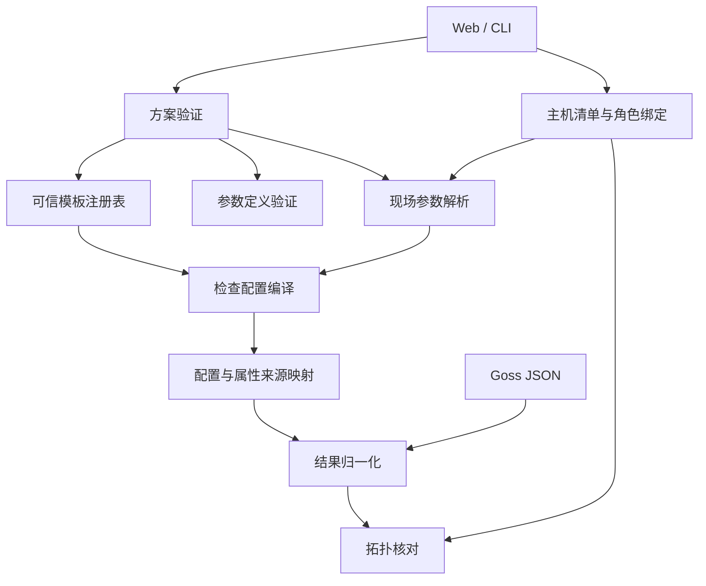

# ReadySpec M1 核心控制面详细设计与实施计划

> 状态：实施中；有效评审意见已纳入，按垂直切片推进  
> 日期：2026-11-05  
> 范围：可信模板库、参数解析、Goss 编译、结果归一化及 Web 模板编排  
> 上游契约：`SPEC.md`、`GLOSSARY.md`、`DESIGN.md`  
> 评审报告：`docs/m1-core-control-plane-review-grok-4.7.md`

## 1. 目标与交付边界

本阶段完成以下用户流程：

> 新建方案 → 选择节点角色 → 添加内置模板 → 配置检查参数与现场可调范围 → 保存草稿 → 严格校验 → 编译检查配置 → 导出自包含方案。

同时提供纯本地、可自动测试的核心链路：

> 方案 + 主机角色绑定 + 现场参数值 + 已提供的目标能力信息 → 参数解析 → Goss 配置编译 → Goss JSON 结果解析 → 检查项结果归一化。

本阶段不连接真实目标主机。目标能力信息由测试夹具或后续执行器传入，Web 中不得将静态编译成功显示为环境就绪。

| 纳入本阶段 | 后续阶段 |
|---|---|
| 可信内置模板注册表 | SSH 连接与凭据管理 |
| 36 项模板的参数与编译契约 | Run Manager、队列、取消 |
| 参数类型、默认值、现场覆盖解析 | 真实目标能力发现 |
| 主机清单与角色绑定的静态解析 | 远端 Goss 投递与执行 |
| 分执行方式编译与属性来源映射 | SSE 进度推送 |
| Goss JSON 到检查项结果的归一化 | 正式发布与报告归档 |
| Web 添加模板和参数编辑 | 远端残留清理 |

完整 M1 仍包括全部 36 项模板。首批模板是用于验证架构的增量交付，不代替最终验收。

## 2. 当前实现与需补齐的能力

现有代码已经具备：

- SafeYAML、JSON Schema、语义摘要与模板快照锁。
- 草稿保存与严格校验分离。
- 模板默认值、检查项参数及显式空值的基础验证。
- 工作区互斥、原子持久化、会话及 CSRF 防护。
- 双架构官方 Goss 二进制内嵌与完整性校验。

主要缺口及改造方向：

| 当前状态 | 本阶段改造 |
|---|---|
| 模板目录写在 `web/src/catalog.ts` | 后端维护模板定义，前端通过 API 获取 |
| 没有本地可信模板注册表 | 建立 ID、版本、摘要一致性校验 |
| `plan.Load()` 无条件拒绝特权模板 | 仅接受与本地可信注册表完全匹配的模板 |
| 参数校验只返回是否合法 | 输出有效参数值及来源 |
| 没有 Goss 编译器 | 引入带来源信息的中间表示和确定性编译 |
| 没有结果归一化模块 | 按属性映射还原到角色、检查项 |
| 模板只有查看入口 | 支持添加、配置、复制及导出 |

`allowed_os` 已从方案级策略移除。本设计不重新引入发行版白名单；需要发行版要求时，通过具体检查项表达。

## 3. 模块结构与依赖

建议新增以下模块，名称在实施时遵循仓库现有风格微调：

```text
internal/
  plan/           方案读取、Schema、引用与摘要验证
  template/       模板定义、可信注册表、实现选择
  parameters/     参数解析、类型转换、覆盖冲突
  inventory/      主机清单解析与角色绑定
  compiler/       Goss 中间表示、合并、配置输出
  result/         Goss JSON 解析、检查项结果归一化
  topology/       架构、节点数量、混部与覆盖核对
  goss/           官方 Goss 资源与完整性校验
  webui/          HTTP API 与编排
```

依赖方向：



领域模块不依赖 HTTP、React 或工作区文件路径。Web 和 CLI 共享同一套业务接口。

不提前引入通用插件框架。模板实现以注册表中的受控 Go 实现为主，等出现真实扩展需求后再抽象。

## 4. 可信模板库

### 4.1 模板身份

保持现有身份三元组：

```text
template_id + version + digest
```

`H02`、`S01` 等目录编号沿用现有目录作为稳定标识。模板内容发生影响参数、断言、执行方式或证据语义的变更时，必须增加版本，不能覆盖同版本内容。

注册表负责：

- 按 ID、版本查找模板。
- 返回模板参数 Schema、执行方式、取证方式。
- 验证内嵌模板定义与锁定摘要。
- 将模板实现标识关联到本地编译器。
- 判断模板是否具有本地特权信任。

### 4.2 模板定义与实现

模板快照继续包含现有字段：

```text
schema_version
template_id
version
name
source
domain
execution_mode
evidence_mode
params_schema
implementation
digest
```

`implementation` 收紧为明确的实现变体，例如：

```json
{
  "kind": "BUILTIN",
  "compiler": "logical_cpu_count",
  "compiler_version": "1"
}
```

自定义 Shell 保留 `CUSTOM_SHELL` 独立变体及现有草稿形状。导入文件中的 `compiler` 只用于核对，不能作为分派键，也不能加载任意代码、文件或命令。所有内置实现（含普通执行）只通过本地注册表的 ID、版本和重新计算的内容摘要精确匹配后分派；草稿重签不能获得注册表信任。

必须分别判断：

1. **内容完整性**：快照、锁与引用摘要一致。
2. **实现可用性**：本地能够编译该实现。
3. **特权可信性**：特权模板与本地注册表完全匹配。

摘要一致本身不授予特权。

### 4.3 特权模板规则

`PRIVILEGED` 模板必须满足：

- 声明来源为内置模板。
- ID、版本存在于当前二进制注册表。
- 快照摘要与本地可信摘要一致。
- 对应实现确实声明支持特权方式。

任一条件失败，严格校验和编译均拒绝。

`USER_PUBLIC`、`PLAN_LOCAL` 模板仍只允许普通执行。自定义 Shell 不允许通过模板内容获得 sudo 能力。

### 4.4 分批可用状态

模板 API 将“定义存在”和“实现可用”分开：

| 状态 | Web 行为 |
|---|---|
| 只有规格定义 | 可查看，不允许加入方案 |
| 已通过编译与映射测试 | 允许加入和配置 |
| 当前程序不支持其版本 | 显示原因，禁止编译 |

这些状态来自后端实际注册情况，不由前端写死。

## 5. 参数系统

### 5.1 参数声明

JSON Schema 继续承担类型、范围、枚举和组合约束。容量、时长、路径等领域类型使用明确的扩展元数据描述，避免滥用标准 `format`。

```json
{
  "type": "string",
  "title": "最低物理内存",
  "x-readyspec-type": "capacity",
  "examples": ["8 GiB"]
}
```

前端依据元数据选择控件，后端负责最终解析和校验。前端校验仅用于及时反馈。

### 5.2 三态赋值

| 状态 | 含义 |
|---|---|
| 未设置 | 继承模板默认值 |
| `params` 中显式赋值 | 覆盖模板默认值 |
| `explicit_null_params` | 明确覆盖为 null |

同一参数同时出现在 `params` 和 `explicit_null_params` 中仍为错误。

解析后的参数记录：

```go
type ResolvedParam struct {
    Value  any
    Source ParamSource
}
```

来源包含模板默认、检查项设定、组级现场值、主机级现场值。显式空值保留对应来源。

### 5.3 覆盖顺序

```text
模板默认值
  → 检查项设定
  → 主机组现场值
  → 主机现场值
```

现场值只能覆盖 `overridable_params` 中开放的参数。

同一主机属于多个组时：

- 多组给出相同值：接受。
- 多组给出不同值：存在主机级值时由它消歧。
- 多组给出不同值且无主机级值：返回 `OVERRIDE_CONFLICT`。

结果不依赖组遍历顺序。领域参数按规范化后的值判断覆盖是否相等，错误不包含敏感原值；严格校验与编译复用同一个解析器。

### 5.4 类型规范化

领域语法在严格校验时检查，规范化值用于编译与覆盖比较，不修改原方案中的用户表达。未支持的 `secret_ref`、版本比较策略等明确拒绝，不作为普通字符串降级：

| 类型 | 编译值 |
|---|---|
| capacity | 精确字节数，检查溢出 |
| duration | 统一时长单位，检查范围 |
| path | 经约束验证的目标路径 |
| port | 1–65535 整数 |
| ip_or_cidr | 标准化地址或网段 |
| regex | 已验证的正则表达式 |
| version_constraint | 带明确比较规则的版本约束 |

软件包版本不能统一套用 SemVer。Debian、RPM、内核和语言运行时版本需要各自的比较策略，未实现的策略必须明确拒绝。

## 6. 主机清单与编译输入

编译器不自行读取主机清单文件，也不发起 SSH。

主机清单模块将快速主机表、Ansible INI/YAML 转换为统一结构：

```text
Host
  id
  address
  port
  groups
```

本阶段只接受明确支持的清单字段，不执行 Ansible 插件、Jinja 表达式或外部脚本。

角色分配、组关系和现场参数值构成静态执行配置。凭据不进入检查方案；后续 M2 使用独立的内存凭据接口。

编译入口分两层：

- **静态预检**：可在没有目标能力信息时完成参数、引用、已知资源冲突检查。
- **主机编译**：接受已提供的架构、工具能力、服务管理器等信息，选择具体实现并输出工件。

未知能力不能被默认当作支持，也不能触发本机命令探测。

## 7. Goss 编译器

### 7.1 输入与输出

建议的核心接口：

```go
func CompileHost(
    plan ValidatedPlan,
    host HostBinding,
    capabilities HostCapabilities,
    overrides FieldOverrides,
) (HostArtifacts, error)
```

`HostArtifacts` 包含：

- 普通执行配置。
- 特权执行配置。
- 受控辅助工件（确有需要时）。
- 属性来源映射。
- 工件摘要及所需能力。

编译函数是确定性的纯计算过程，相同输入产生相同输出。

### 7.2 编译中间表示

各模板先生成类型化资源断言，再统一合并，不能直接拼接 YAML：

```text
ResourceAssertion
  execution_mode
  resource_type
  resource_key
  property
  matcher
  origins[]
```

`origins` 至少记录：

```text
role_id
item_id
template_id
template_version
```

普通与特权配置独立合并，禁止跨执行方式共享资源配置。

### 7.3 合并与冲突

首版仅实现能够证明正确的合并规则：

| 断言组合 | 行为 |
|---|---|
| 相同属性、相同期望 | 合并，保留全部来源 |
| 同一资源、不同且独立的属性 | 合并 |
| 精确值不同 | 冲突 |
| 存在与不存在 | 冲突 |
| 不同数值范围 | 首版拒绝合并，保留各方原始期望；后续只有能够从同一观测值独立重判各原始断言时才支持共享采集 |
| 无法证明兼容的复杂匹配器 | 拒绝合并并说明原因 |

复杂正则不尝试推断交集。对独立 command 资源使用稳定的独立键，避免无必要的合并。

冲突错误必须定位到资源、属性、角色和检查项，不能只返回“编译失败”。

### 7.4 自定义 Shell

用户脚本与参数值始终分离：

- 脚本作为独立内容保存。
- 参数名符合 Shell 环境变量标识符规则。
- 参数值经 POSIX 单引号转义。
- 环境变量注入后设为只读。
- 参数内容不拼进脚本源码。

包含 NUL 的值拒绝编译。换行、单引号、反引号、`$()` 等必须有回归测试，证明不会改变脚本结构。

### 7.5 Goss 能力验证

不能仅根据规格推断 Goss v0.4.9 支持某种资源属性。实施前必须用内嵌官方二进制验证：

- 实际配置格式。
- 匹配器语义。
- JSON 输出结构。
- command 输出与错误的保留方式。
- 超时、非零退出与证据错误的区分能力。

优先使用原生资源；需要 command 包装时，使用受控实现。

若某项无法在锁定的 Goss 上可靠实现，必须记录为未完成，不得通过二次执行检查命令来补结果。

## 8. 属性来源映射与结果归一化

### 8.1 映射结构

映射键由执行方式、资源类型、资源键和属性组成，一个属性可以关联多个检查项。

一个检查项也可以依赖多个属性，例如：

```text
路径要求
  → exists
  → filetype
```

映射与配置一同生成，并通过摘要绑定，防止使用错误版本的映射解释结果。

### 8.2 归一化规则

按现有领域状态生成 `ItemResult`：

- 证据完整且断言满足：`PASS`。
- 证据明确证明要求不满足：`FAIL`。
- 命令失败、超时、输出不可解析、预期属性缺失：`ERROR`。
- 已确认目标能力不支持该检查：按模板契约产生 `UNSUPPORTED`。
- 禁用或范围排除：`SKIP`。

“字段缺失”不能推导成通过。未知结果属性、重复结果、无法关联的资源都需要显式诊断。

多属性检查项同时存在明确失败和证据错误时，保留全部明细，顶层记录明确不满足；不得丢失并存的证据错误。

### 8.3 拓扑与就绪结论

拓扑模块独立核对：

- CPU 架构允许范围。
- 节点角色数量与混部。
- 实机身份唯一性。
- 必检检查项覆盖完整性。

OS 发行版不在方案级拓扑中核对。

`Verdict` 按规格推导。模拟、试跑、局部检查及静态编译成功均不能生成放行级 `READY`。CLI 最终退出码推导与业务结论分离，以保留取消等优先级规则。

## 9. HTTP API

沿用现有会话、CSRF 和 Origin 保护。

| 接口 | 用途 |
|---|---|
| `GET /api/v1/templates` | 查询目录、版本、能力状态 |
| `GET /api/v1/templates/{id}/{version}` | 获取完整模板快照及参数定义 |
| `POST /api/v1/plans/validate` | 保留现有严格校验语义，补充诊断定位 |
| `POST /api/v1/plans/compile` | 零网络静态编译预检 |

编译接口可返回：

```text
plan_digest
compilation_status
diagnostics[]
roles[]
required_capabilities[]
```

完整主机编译工件由内部接口提供，后续执行器复用。Web 默认展示用户可理解的结果；Goss YAML 和属性映射放在“编译详情”中。

诊断对象建议包含：

```json
{
  "code": "RESOURCE_CONFLICT",
  "message": "同一路径的存在性要求冲突",
  "role_id": "app",
  "item_id": "data-directory",
  "parameter": null,
  "related_items": ["another-check"]
}
```

响应不包含敏感参数原值。错误响应保留现有 `error` 字符串，并可附加 `diagnostics`。错误定位能力应由后端提供，前端不解析错误字符串猜测字段。

## 10. Web 工作台

### 10.1 添加模板

1. 用户选择节点角色。
2. 打开模板选择器并搜索或按领域筛选。
3. 查看模板说明、取证方式、执行方式和参数。
4. 选择可用模板并添加。
5. 创建独立检查项，将模板快照加入方案并建立引用。

同一个模板版本可被多个检查项复用；参数值存放在检查项中，互不影响。

### 10.2 参数编辑

控件覆盖：

- 字符串、数字、布尔值。
- 单选和多选枚举。
- 容量、时长、路径。
- 列表、键值映射。
- 版本约束、正则。

每个参数显示：

- 名称和说明。
- 当前值或继承默认值。
- 是否显式为空。
- 是否允许现场调整。
- 校验错误。

复杂 Schema 暂无专用控件时提供受约束的 JSON 编辑入口，不能因为前端无法展示就丢弃或重写原值。

### 10.3 校验与保存

| 动作 | 保证 |
|---|---|
| 保存草稿 | 编辑内容持久化 |
| 严格校验 | 方案结构、参数、引用和摘要有效 |
| 编译预检 | 支持的实现可编译，已知资源要求无冲突 |

任何成功提示都不表示目标环境通过检查。

## 11. 兼容性与升级

- 保持现有方案自包含快照机制。
- 不在导入时自动替换模板版本或刷新摘要。
- 同 ID、版本而摘要不同，明确拒绝。
- 特权模板升级采用精确版本匹配，不隐式兼容旧摘要。
- `allowed_os` 继续按已确认决定拒绝，不静默删除。
- 新增实现格式需要同步 Schema、示例及兼容性说明。
- 旧草稿中未完成的普通编辑内容仍允许保存，但无法编译的实现必须在严格校验或编译阶段明确报错。

## 12. 测试与验收

### 12.1 核心测试

每个模板至少覆盖规格要求的六类场景：

1. 满足要求。
2. 明确不满足。
3. 阈值边界。
4. 环境或权限错误。
5. 现场参数覆盖。
6. Goss 属性映射。

额外覆盖：

- 伪造内置身份、重签摘要、特权升级。
- 参数三态、同级组冲突、未知参数。
- 容量溢出、版本比较、特殊路径与 Shell 转义。
- 合并顺序无关性和确定性输出。
- JSON 属性缺失、重复、无法关联。
- 一个属性关联多个检查项、一个检查项关联多个属性。

### 12.2 集成测试

使用内嵌 Goss 对隔离测试目录和受控测试命令执行，验证真实配置与 JSON 输出，避免只比较生成的 YAML 文本。

测试不能检查宿主真实 SSH 配置、修改系统参数或访问生产服务。需要真实目标能力的场景使用后续专用集成环境验收。

### 12.3 Web 测试

覆盖添加模板、独立参数编辑、默认值恢复、现场可调、复制删除、保存重开、导入导出以及编译错误定位。

继续保留非回环 HTTP 下首屏启动的回归测试。

## 13. 实施顺序

| 批次 | 内容 | 完成标准 |
|---|---|---|
| A | 可信注册表、参数解析、诊断结构 | 伪造信任被拒绝，参数结果及来源确定 |
| B | S01 编译、映射和归一化垂直切片 | 路径模板真实 Goss 配置与结果映射通过 |
| C | 扩展 H02、H03、S04，完善编译合并与归一化 | 冲突可定位，数值观测保真，结果不丢失、不串位 |
| D | 模板 API、Web 添加和参数编辑 | 完成编辑、保存、编译、导出闭环 |
| E | 主机清单、组覆盖与角色绑定 | 静态主机编译输入完整可用 |
| F | 扩展全部 36 项及拓扑核对 | 全部六类模板测试及集成测试通过 |

每批交付都更新内嵌前端，并重建默认及三个发布二进制。

## 14. M1 最终验收条件

- 36 项模板均有明确参数和可验证实现。
- 方案可按主机编译出分执行方式的工件。
- 结果可准确还原到角色和检查项。
- 资源冲突、未知能力与证据缺失均明确报错。
- Web 完成模板编排闭环。
- 上述能力通过对应单元、集成和浏览器测试。

满足这些条件后，再进入 M2 的真实 SSH 与任务执行。

## 15. 实施记录（2026-11-05，持续更新）

M1 已按本节第 14 节条件完成验收。逐项采集证据和 M1/M4 范围对照见 [模板验收对应表](m1-template-acceptance.md)。下方早期增量记录是阶段快照；六个发行版/架构的目标矩阵仍按 SPEC §17 TODO-01 归 M4，不在此声明已认证。

- 已落地可信注册表、普通内置模板与特权模板的内容信任校验、严格实现变体 Schema。
- 严格校验与编译共享参数解析器，支持参数来源、三态和组/主机覆盖；已实现容量、时长、路径、端口、IP/CIDR 与正则领域校验。版本策略及秘密引用仍明确拒绝。
- 已注册全部 36 个模板家族、37 个可信快照，均有编译入口。R04 额外提供 `1.0.0-config`，将 systemd 配置证据与目标 PID 的有效限制分开。A03 仅生成特权工件；L02/L03 已按 SPEC 恢复 STANDARD，并检查日志文件读取权限。
- 已落地确定性 Goss JSON 配置、普通/特权独立工件、配置字节摘要、属性原始期望与来源映射、结构化冲突诊断及结果归一化。复杂属性仍仅合并相同期望。
- 已提供主机角色选择、现场覆盖编译接口、静态主机清单解析及拓扑/Verdict 纯函数。INI/YAML 组级用户与端口按父组→子组→主机覆盖，同级冲突须主机消歧。
- 已接通模板目录/版本 API、Web 内置模板添加/参数编辑/静态编译及主机绑定预览，以及 CLI `template list` / `plan compile` / `run preview`。未指定主机绑定时按角色独立编译，明确同机绑定才合并。
- 官方 Goss 集成测试覆盖临时文件、数值观测与采集失败、本地 TCP/DNS/HTTP 夹具；自定义 Shell 参数转义有实际执行回归。大多数自动化测试使用隔离夹具；最终验收还在专用 VM 对真实网络、LDAP/NSS、运行时、systemd 与 journal 副本执行了原工件检查。
- 自动化验证覆盖全目录正反向行为、工件往返序列化、官方 Goss 匹配器协议、生成 Shell 语法及隔离文件/TCP/DNS/HTTP 采集。大整数按原始阈值精确比较；配置证据脱敏；日志零事件必须有窗口覆盖证明，OOM 关联同时匹配 PID 与时间。
- 最终本地验证：`go test -race ./...`、`go vet ./...`、16 项 React 测试、4 项 Playwright 流程（含模板编排与主机静态预览）、TypeScript/Vite 构建通过。`make build-all` 和默认 `dist/readyspec` 构建通过，产物版本为 `0.2.0-dev`。现有 README/SPEC 的 Markdown 双空格换行会触发 `git diff --check` 尾随空格提示，未修改这些既有文档行。

本轮补齐：AppArmor enforce/complain 模式读取内核 profiles；N02 指定地址空闲与双栈套接字判定；O03 缺键 FAIL 与拒读 ERROR；S02 缺路径 ERROR；N03 DNS 错误分类；N05 响应读取上限、摘要与 TLS/重定向分支。N03/N05 因 Goss v0.4.9 对应资源不能提供所需错误分类或读取上限，使用 Goss command 包装受控 Python 标准库采集并声明 `tool:python3`；N02 使用 `ss` 保留绑定地址及 v6only 信息。原编译工件隔离采集测试与全目录匹配器测试分别维护。

阶段快照：原工件隔离采集进一步验证并修复 H03/H04/D05，强制隔离目标当时为 145 个测试/子测试通过、0 失败、0 跳过；最终扩展与验收见文末记录及模板验收表。

存储证据增量：S02 无论声明哪些属性要求均采集 UID/GID、属主属组和模式；S03 补 source、类型和活动选项。仅用于证据的属性显式标记 `observation_only`，不生成额外业务约束；共享采集可使用同资源已有断言匹配器，但每条原始断言仍独立归一化，冲突断言仍拒绝。S04/S05 使用 GNU stat 的只读文件系统计数和 mountinfo，输出完整容量/inode/挂载信息，按原始整数或有理数判定。隔离测试包含真实文件和 bind mount，并以独立 syscall.Statfs 核对统计；本增量不表示其他模板缺口已完成。

存储增量最终验证：强制隔离采集目标 171 个测试/子测试通过、0 失败、0 跳过；全量竞态测试、go vet、4 项 Playwright 流程通过，前端/三平台及默认二进制已重建。S02–S05 对应的本轮证据缺口关闭，其余项目继续以对应表为准。

NSS 增量：A01/A02 已改为受控 Python ctypes 调用 libc 的 getpwnam_r/getgrnam_r，通过 Goss command 返回可分类的观察记录。原生静态 Goss user 不能满足配置 NSS 提供者的查询和故障分类，A02 也不再只读取本地 passwd/group。已声明 tool:python3 与 libc:glibc-nss；configured files/compat 数据库无法读取时 ERROR；不存在结果另核对 NSS 提供者状态，不能把被继续策略隐藏的不可用/重试当作 NOTFOUND。A02 使用组条目附加成员和必需用户主 GID，证据标明查询范围；不枚举全部用户或采集密码/个人说明/主目录。大 UID/GID 按数值精确比较；含 NUL 的名称和“要求不存在但又断言属性”的输入被严格校验拒绝。隔离 NSS 共享模块测试覆盖实际 libc 调用，尚不代表真实目录服务平台认证。

历史阶段快照：NSS 自动化测试通过；当时尚未运行真实目录服务。文末记录补充了真实 OpenLDAP→SSSD→libc NSS→A01 原工件验收。

D04 增量：动态 ELF 与真实共享库、私有缓存和执行哨兵已加入原工件隔离验收。原实现只匹配缓存库名，现改为结构化静态采集（目标能力 readelf/ldconfig/python3），核对缓存 flags 和实际候选 ELF 的 class/machine/byte_order/type，校验文件/程序头边界及 PIE 动态标记。缺失/非法/错误 ABI 候选 FAIL，不可读或查询失败 ERROR。目标解释器、库构造器和 ldd 哨兵均通过阳性对照，采集时不触发。保留完整 NEEDED 和缓存候选证据；未将这项静态取证描述成运行时加载保证。

D04 增量最终验证：强制隔离采集目标 229 个测试/子测试通过、0 失败、0 跳过；全量竞态测试（compiler 130.771s）、go vet、4 项浏览器流程通过；前端、默认及三平台二进制构建完成。本轮无前端源码修改，其他模板验收缺口保留。

日志增量：L02/L03 不再仅凭一条早于窗口的记录推断完整覆盖，增加无 unit/transport 过滤的系统 journal 游标连续性审计。序号跳跃、序号域改变、丢失消息提示、无效游标/时序、10000 条上限和读取诊断均使覆盖无法证明；归一化分别记录 window_boundary_proven、continuity_proven/reason、coverage_proven 与 truncated。allow_since_boot 的当前启动证据和连续性同时验证；内核查询改为 _TRANSPORT=kernel，避免 -k 隐含仅查本次启动而漏计窗口内前次启动。新原工件接口测试覆盖这些分支及 OOM/服务事件去重与计数，未将受控 journalctl 输出描述为真实二进制 journal 损坏/轮转认证。

日志增量最终验证：强制隔离采集目标 286 个测试/子测试通过、0 失败、0 跳过；全量竞态测试（compiler 182.626s）、go vet、4 项浏览器流程通过；前端、默认及三平台二进制已重建。其余模板缺口继续以对应表为准。

HTTP 总预算增量：N05 全部分支统一受控采集，用监督进程的 deadline 约束采集子进程启动及全部网络阶段，超时后终止并回收；外层 Goss timeout 为配置预算加 2 秒处理余量。响应链累计状态行/头最多 64 KiB，连同读取正文合计最多 1 MiB；重定向最多 10 次，不读取中间正文。证据增加 header_bytes/response_bytes/duration_ms/redirects 和对应上限。原工件本地慢正文/连续重定向/精确字节头及总响应边界、缺正文回归覆盖；原生 HTTP 状态路径也纳入 Python 能力声明。

HTTP 增量最终验证：强制隔离采集目标 303 个测试/子测试通过、0 失败、0 跳过；最终代码全量竞态测试（compiler 188.555s）、go vet、4 项浏览器流程通过；前端、默认及三平台二进制已重建，产物 N05 requires 明确包含 tool:python3。H01 原始架构证据及对应表中其他缺口仍未关闭。

H01 增量：原工件直接采集 LC_ALL=C uname -m 的 stdout，不经 Shell 命令替换归一化，避免覆盖别名原文及吞掉末尾空行/NUL。控制面同时输出 uname_raw 与 normalized_architecture；amd64/arm64 映射至 x86_64/aarch64，格式有效但不在允许集合的架构 FAIL，空/多行/空白/NUL 等异常输出 ERROR，命令失败保留退出码且 ERROR。隔离原工件用例覆盖这些分支，并验证来源和观测起止时间保留；其余未完成项继续按对应表推进。

H01 增量最终验证：强制隔离采集目标 318 个测试/子测试通过、0 失败、0 跳过；全量竞态测试（compiler 200.325s）、go vet、4 项浏览器流程通过；前端、默认及三平台二进制已重建。没有新增 H01 目标依赖，仍要求 uname；其他模板待补项未据此关闭。

H02 增量：将真实 getconf 与隔离 sysfs 的预研纳入原工件测试。配置 8 核而仅在线 2 核时，独立配置数查询为 8，原工件在线观测为 2，阈值 2 PASS、3/8 FAIL；非零编号和稀疏在线集合也验证正确。来源及采集起止时间均断言，未用输出替身代替 getconf/libc。现有实现无需修正，仅新增测试及验收记录；H03/H04 及对应表其他未完成项继续保留。

H02 增量最终验证：新增原工件测试竞态检查及 go vet 通过；强制隔离采集目标 331 个测试/子测试通过、0 失败、0 跳过。因本轮未修改生产代码和前端，不重复全量竞态/浏览器/构建；前一轮的全量验证保留为历史结果。

H03/H04 增量：新增原工件隔离 meminfo/swaps 测试，覆盖重复 MemTotal、损坏表头/字段/记录、非法数值、GB/GiB 与精确容量邻界。控制面收紧 procfs 无符号计数格式，拒绝正号/负零和零 MemTotal；Swap 验证文件/分区类型、绝对路径和设备唯一性，避免重复设备伪造总量。原有 used<=size、优先级负值、合法零容量活动状态与大整数计算保留。损坏内容用例核对原 awk/cat 成功读文件后归一化 ERROR；其余验收缺口继续以对应表为准。

H03/H04 增量最终验证：强制隔离采集目标 386 个测试/子测试通过、0 失败、0 跳过；全量竞态测试（compiler 227.124s）、go vet、4 项浏览器流程通过；前端、默认及三平台二进制已重建。其他模板的待补项未据此关闭。

O01/O02 增量：新增 os_version.go，分开处理 os-release 的 shell 风格数据赋值和 uname 的单行内核版本。O01 支持单/双引号、相应反斜杠规则和注释，不执行文件、不展开变量、不拼接引号，避免 Go 字符串转义误读；保留 os_id/version_id/raw_fields，省略无关字段。O02 保留 kernel_raw、normalized_version 与 release_suffix，数字分段比较并补足缺省修订号，格式异常/溢出/查询失败 ERROR。原工件隔离测试覆盖重复/缺失字段、转义、未知发行版、版本上下界和异常内核输出；无新增目标工具依赖。

O01/O02 增量最终验证：强制隔离采集目标 439 个测试/子测试通过、0 失败、0 跳过；全量竞态测试（compiler 250.341s）、go vet、4 项浏览器流程通过；前端、默认及三平台二进制已重建。O03/O04 等剩余验收项继续保留。

O03/O04 增量：新增 kernel_state.go 与原工件隔离采集测试。sysctl 先用 stat 区分缺键和访问故障，再直接 cat 保留原文；避免 Shell 替换消除异常。数值模式限定十进制标量并精确比较，字符串模式独立支持文本/向量；保留 value_raw/value/exists。模块采集改用 cat，校验整表六字段与可选 taint、重复名称及依赖字段，兼容 '-' 引用计数与永久标记；稳定 Live 状态才用于目标加载判定，过渡态 ERROR；不输出内核地址。目标能力 O03 增加 stat，O04 改为 cat；固定目录夹具同步为实际模块记录。

O03/O04 增量最终验证：强制隔离采集目标 500 个测试/子测试通过、0 失败、0 跳过；全量竞态测试（compiler 278.888s）、go vet、4 项浏览器流程及全部发布产物构建通过。复核 Normalize 最终聚合确认 collectionError 优先返回 ERROR，模块读取失败不会被空输出导致的业务 FAIL 覆盖。其他模板验收缺口继续保留。

S01 增量：保留原存在性/类型断言及资源冲突语义，增加独立 Python lstat/readlink/stat 元数据命令。节点和链接目标分别取证，JSON 保留原始链接文本、目标存在性/类型及跟随策略。目标访问故障在不跟随时只记录 target_error，跟随时 ERROR；悬空链接按策略区分节点存在与目标缺失。原工件测试使用隔离真实文件/链接/目录和权限，覆盖相对/绝对/链式/换行目标、悬空与循环，并验证来源和时间。注册表新增 python3 能力声明；不提供跨资源原子快照保证。

S01 增量最终验证：强制隔离采集目标 522 个测试/子测试通过、0 失败、0 跳过；全量竞态测试（compiler 287.417s）、go vet、4 项浏览器流程及前端/默认/三平台二进制构建通过。所有后台验证完成，其他模板待补项继续保留。

R02 增量：在 N01 网络配置权限阻塞期间独立推进进程取证。查询改为 LC_ALL=C ps -eo pid=,comm=，完整验证进程表后按 comm 精确计数，避免空/损坏输出被当作零匹配通过；无效或重复 PID、NUL/空行等异常 ERROR。归一化只保留请求名和统计摘要，省略 PID、无关名称与命令行。原工件隔离 PID/procfs 测试通过真实子进程和 ps 验证零匹配/超上限/精确数量及秘密参数脱敏，接口夹具补格式异常与上下界。未新增 R02 目标依赖，未放宽 N01 强制隔离验收。

R02 增量最终验证：显式排除 N01 网络配置阻塞测试的强制采集子集 543 个测试/子测试通过、0 失败、0 跳过；全量竞态测试各包通过（compiler 298.039s，普通模式下 N01 的 7 个配置场景因权限不足跳过）；go vet、默认及三平台 Go 二进制构建通过。前端未修改，未重复相关构建与浏览器测试。所有后台验证已结束，N01 及其他未完成验收项继续保留。

R03 增量：新增 load.go 与原工件隔离 loadavg 测试，复现旧 awk 只验证选中字段、遗漏其他损坏或缺失字段的误 PASS。改为真实 cat 完整采集，在控制面校验五字段及单行格式，之后选择 1/5/15 分钟窗口做精确十进制比较。证据保留 window_minutes/load_average/maximum 及测量含义，不把负载解释为 CPU 百分比。测试覆盖三个窗口的上下邻界、零与大数小数、非法字段/损坏布局/缺失或拒读和合法空白布局。注册表工具由 awk 改为 cat，保留 procfs 要求；N01 权限阻塞继续保留。

R03 增量最终验证：显式排除 N01 网络配置阻塞测试的强制采集子集 592 个测试/子测试通过、0 失败、0 跳过；全量竞态各包通过（compiler 322.043s，普通模式下 N01 7 个配置场景权限不足跳过）。go vet、默认及三平台 Go 二进制构建通过，R03 产物工具声明为 cat/procfs。前端未改，未重复相关检查。其他未完成项继续保留。

R04 增量：新增 limits.go 统一校验 PID 有效限制及 systemd 配置限制。PID 路径读取指定 Limit 行的软/硬值与 units，拒负值、符号、小数、重复行、损坏未选边界、软高于硬及不匹配单位；保留两边值和选择边界的证据，unlimited 视为满足最低值。Unit CONFIG 分支要求单个有限整数或 infinity/unlimited 标量，拒额外行与非整数。原工件隔离测试以 Python 辅助器建立两个 namespace 子进程限制并通过 PID procfs 与真实 cat 读取，覆盖 NOFILE/NPROC 两种资源的 soft/hard/比较邻界及子进程退出；测试后回收进程。固定夹具覆盖非法表内容及 Unit 查询失败，CONFIG 与 EFFECTIVE_STATE 类型仍严格区分。无新增目标依赖，N01 网络配置阻塞保持独立。

R04 增量最终验证：显式排除 N01 网络配置阻塞测试的强制采集子集 638 个测试/子测试通过、0 失败、0 跳过；全量竞态各包通过（compiler 343.486s，普通模式下 N01 7 个配置场景权限不足跳过），go vet、默认及三平台 Go 二进制构建通过。结果包含 R03/R04 实现，不关闭 N01 及其他待验收项。

R05 增量：新增 time_sync.go，原文与退出码通过分段帧采集，不再让 Shell 替换吞掉空行/NUL。控制面先验证 NTPSynchronized 单标量及所有允许服务的 active-state/退出码对应关系，再判同步标志和至少一个活动服务；多行、未知状态、矛盾或工具失败 ERROR。保留 synchronized/active_services/service_queries 摘要，未知诊断不原样发布。接口测试覆盖全部服务别名与组合及异常输出，兼容 missing-unit 退出 4/状态 inactive；没有在宿主启动真实服务或改时钟。无新增目标依赖，仍需 timedatectl/systemctl；N01 阻塞及真实时间服务认证继续保留。

R05 增量最终验证：显式排除 N01 网络配置阻塞测试的强制采集子集 671 个测试/子测试通过、0 失败、0 跳过；全量竞态各包通过（compiler 359.262s，普通模式下 N01 7 个配置场景权限不足跳过），go vet、默认及三平台 Go 二进制构建通过。无前端变更未重复浏览器测试。

R01 增量：新增 service.go 解析并记录三个独立 systemd 属性，拒未知/缺失/重复状态而非当作 false，未安装保持 FAIL、查询非零保持 ERROR。查询添加 --all 保留空属性；活动/重载/刷新算运行，enabled/enabled-runtime 算启用，其他有效 UnitFileState 仍独立记录。原工件接口测试覆盖运行/启用组合及未安装/停止/失败、查询故障/损坏输出，验证来源/时间及诊断不泄漏；未操作真实宿主服务。目标依赖仍为 systemctl。

R01 增量最终验证：显式排除 N01 网络配置阻塞测试的强制采集子集 711 个测试/子测试通过、0 失败、0 跳过；全量竞态各包通过（compiler 375.841s，普通模式下 N01 7 个配置场景权限不足跳过）；go vet 与默认/三平台 Go 二进制通过。R01 原工件测试为 systemctl 接口夹具，真实 manager 集成认证仍未做；其他待验收项继续保留。

D02 增量：新增 command_metadata.go 和原工件隔离测试，以 Python stat/access 统一显式路径与 PATH 元数据检查，避免 command-v 和 -f 将不可访问路径误作不存在。支持相对路径、PATH 空项/相对目录及后续可执行候选；保留普通文件即便无执行位的事实，再按 executable 要求判定。缺失/断链/目录 FAIL，访问拒绝或循环 ERROR。元数据不读取或执行目标内容；命名空间内可写执行哨兵及阳性对照验证采集不执行目标。新增目标 python3 能力、移除 stat 依赖，旧固定观察切换 JSON 摘要。N01 阻塞与其他待验收项继续保留。

D02 增量最终验证：显式排除 N01 网络配置阻塞测试的强制采集子集 730 个测试/子测试通过、0 失败、0 跳过；全量竞态各包通过（compiler 385.204s，普通模式下 N01 7 个配置场景权限不足跳过）。go vet 与默认/三平台 Go 二进制构建通过，D02 产物明确声明 python3 能力。其他待验收项继续保留。

D03 增量：新增 runtime.go 分段帧采集运行时路径、版本原文与查询退出码，复现旧正则接受垃圾后缀/未闭合引号/横幅版本/重复行的误判。控制面按运行时类型解析已知版本格式（Python 含预发布与 +，Node 保 v 数字与后缀，Java quote/裸记号并归一 1.x），重复或未知格式 ERROR；未安装/搜索路径缺失 FAIL，缺失目标、拒读、不可执行、目录分辨 ERROR；查询非零 RUNTIME_QUERY_FAILED 与解析失败分开。stat 验证执行文件类型后运行版本查询，不加载解释器版本 API；真实各发行版运行时部署认证独立保留。原工件覆盖三类运行时指定/查找路径、未安装、上下界与后缀证据、异常输出及真实 Python --version 原件观察。

D03 增量最终验证：显式排除 N01 网络配置阻塞测试的强制采集子集 762 个测试/子测试通过、0 失败、0 跳过；全量竞态各包通过（compiler 396.410s，普通模式下 N01 的 7 个配置场景因权限不足跳过），go vet、默认及三平台 Go 二进制构建通过，D03 产物声明 runtime-query 与 stat。该子集不代表完整强制采集目标通过，其他待验收项继续保留。

L01 增量：新增 uptime.go，改为 cat 完整读取 /proc/uptime，在控制面校验单行双字段十进制记录后再比较 uptime 秒数；旧 awk 只校验第一字段导致缺第二字段、额外字段、idle 损坏、多行和 NUL 误判。证据保留 uptime_seconds/idle_seconds 与上下界，精确十进制比较超过 2^53 不四舍五入。原工件测试覆盖界限邻界、零值、大数小数、损坏记录与源访问失败；依赖由 awk 改为 cat/procfs。未验证宿主实际运行时长。

D05 增量：JSON Pointer 解析改为独立校验 RFC 6901 转义与数组索引；旧实现把未知 `~` 序列当字面量、接受前导零索引并返回 FAIL，无法区分损坏指针与缺键。现在非法转义、前导零、空数组项与符号/`-` 索引判 ERROR，越界或缺键 FAIL；`~1`/`~0` 解码与 map 中带前导零的字面键保持可用。原工件测试覆盖转义斜杠/波浪键、嵌套数组、类型化 expected、YAML 数组路径、重复 JSON 键与脱敏摘要。未改变 env/ini 解析路径。

D01 增量：包查询不再用 2>&1 把 dpkg-query/rpm 的诊断混入版本数据；成功时只采信 stdout，失败时按需重查一次 stderr 以区分未安装与数据库/锁错误。dpkg 分支校验单行双字段、状态记号与版本字符集；原工件在隔离 status 数据库上使用真实 dpkg-query 和真实 dpkg --compare-versions 验证 epoch/release/tilde 与上下界、未安装及非 installed 状态。RPM 分支以替身验证参数、未安装与锁错误；另用临时解包的真实 rpm 6.0.1 验证 vercmp 的 epoch/release/tilde 语义，未安装或修改宿主 rpm，发行版 rpmdb 查询认证继续独立保留。

A03 增量：新增原工件测试，在隔离根目录生成临时 ed25519 主机密钥与 sshd_config，直接运行宿主真实 /usr/sbin/sshd -T（含 -C Match 上下文）验证生效值、非法配置与缺主机密钥时不回退静态配置。未启动监听或读取真实凭据；认证前置仍属 M2。该测试不改变生产采集代码。

N02/N06 增量：N02 增加映射/作用域/v6only/元数据/损坏 ss 行用例；N06 在隔离网络命名空间用真实 ip -j route get 验证回环、from 源与不可达，并增加策略表元数据与缺工具用例。两者均确认现有生产实现已满足，新增证据仅测试与文档；新建策略规则仍需 CAP_NET_ADMIN，与 N01 一并保留。

A03/N02/N06 增量验证：这三个模板的原工件测试在 -race 下执行通过（15.218s）；它们未改动生产采集代码，L01/D05/D01 的全量竞态（compiler 437.222s）与强制采集子集 811 项结果仍适用于当前生产代码。N01 网络配置阻塞保留。

N04 增量：新增 dns_probe.go 对同一查询读取响应头，区分 NOERROR/NXDOMAIN 与 SERVFAIL/REFUSED/TC 截断/超时/畸形响应；记录集仍由 Goss dns 资源判定。新增 python3 目标能力，证据保留 rcode/truncated/耗时。原工件测试覆盖五种服务失败/截断/畸形与原有八类记录。真实递归解析器差异与策略规则平台认证继续保留。

N04/A04 增量最终验证：强制采集子集 861 个测试/子测试通过、0 失败、0 跳过（显式排除 N01）；全量竞态各包通过（compiler 442.218s，普通模式下 N01 7 个配置场景权限不足跳过）；go vet、默认及三平台 Go 二进制构建通过，N04 产物要求 python3。真实递归解析器、rpmdb、SELinux 内核与策略规则认证继续保持独立缺口。

A04 增量：新增 SELinux 原工件测试，使用 getenforce 替身与隔离 sysfs 验证 enforcing/permissive/disabled、非法值、无 SELinux 目录及 enforce 不可读；不修改宿主安全模块。宿主无 SELinux，真实内核集成认证继续独立保留。

N01 权限诊断补充（开发宿主历史状态）：`apparmor_restrict_unprivileged_userns=1` 阻止非特权网络命名空间配置；未修改宿主 sysctl 或安全策略。后续在 AlmaLinux 9.8 专用 VM 上运行 N01 七个真实网络场景并全部通过。

明确边界：`secret_ref` 和通用 `version_constraint` 类型仍拒绝；具体版本模板使用数字上下界或 Debian/RPM 比较。静态预览返回所需但未验证的目标能力，不连接目标、不验证实际 UID/凭据/sudo，也不产生环境 `READY`。M1 完成不等于 M2 执行能力或 M4 六平台认证完成。

## 16. M1 最终验收记录（2026-11-06）

- 在 Lightsail AlmaLinux 9.8 VM 强制运行完整采集子集：875 PASS、0 FAIL、0 SKIP，未排除 N01；全量 `go test -race ./...`、`go vet ./...` 及 Linux/arm64/Windows amd64 构建通过。真实 journal 专项以 `READYSPEC_TEST_REAL_JOURNAL=1` 显式运行，不与 875 计数混淆。
- 真实原工件验证覆盖 N01/N03/N06、RPM/SELinux、chronyd/systemd、递归 DNS；A01 通过本地 OpenLDAP→SSSD→libc NSS 查询 `m1ldap`；D03 通过 AlmaLinux 上 Python 3.9.25、Node 16.20.2、Java 17.0.21；L02/L03 使用真实 active+rotated journal 副本，正常轮转 PASS、损坏 active journal ERROR。
- OpenLDAP/SSSD 测试结束后恢复 `nsswitch.conf`、移除临时 SSSD 配置、停止 LDAP/SSSD 并清除测试域缓存。journal 测试只改临时副本，不写宿主 journal。
- M1 验收依据为本节 §14 和 SPEC §16 M1 项；目标平台矩阵为 SPEC §17 TODO-01（M0/M4），Windows 原生验证和性能压测为 TODO-03/04（M4），SSH 实际执行属于 M2。不得把 M1 PASS 表述为整个产品或六平台认证完成。
