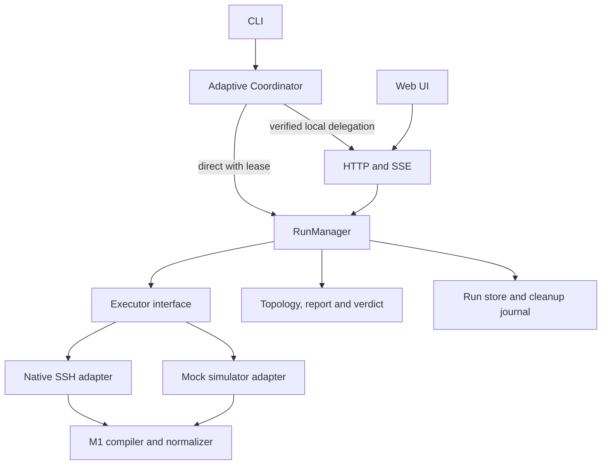

# M2 Implementation Design

**Status:** approved implementation plan; core M2 paths are implemented. M2 acceptance remains open for the platform and integration checks listed in §13.

**Scope:** M2 execution and control plane, building on the M1 Go implementation.

**Sources:** [`SPEC.md`](../SPEC.md) §§3–4, 8–11, 14, 16; [`GLOSSARY.md`](../GLOSSARY.md); [`docs/m1-core-control-plane.md`](m1-core-control-plane.md).

## 1. Goal and non-goals

M2 adds one durable Run lifecycle shared by Web and CLI, a native SSH executor, an offline simulator, and the HTTP/SSE and adaptive CLI paths that operate that lifecycle. A `RunReport` remains the authoritative record; presentation code does not recompute its `Verdict`.

M2 does not include six-platform target certification (M4), automatic target repair, a resident target agent, or activation of `readyspec.custom_result/v1` before its M0 feasibility condition is resolved. Mock execution cannot produce a gate-eligible `READY`.

## 2. Existing modules to reuse

- `internal/plan`, `inventory`, and `preview` provide validated plans, parsed inventory, role binding, overrides, and zero-network preflight preview. Do not reuse `preview.Build` unchanged as submission validation: it currently rejects role-count and colocation violations without a scope argument. Reuse structural validation, override resolution, and compilation; evaluate topology through `topology.Check` with the actual scope. A single-host `PartialRun` must not be rejected merely because a role requires multiple nodes.
- `internal/compiler.CompileExecutionModes` produces separate `STANDARD` and `PRIVILEGED` artifacts. After discovery supplies proved host capabilities, compilation is repeated for that host. `compiler.Normalize` owns Goss result normalization.
- `internal/topology` checks the supplied observations and implements the SPEC `Verdict` rules.
- `internal/goss` supplies integrity-checked original Goss bytes for `x86_64` and `aarch64`.
- `internal/workspace` provides confined atomic JSON persistence and the cross-process exclusive lease. M2 must add confined, lease-protected journal append and recovery support; the current `WriteJSON` is neither a multi-file transaction nor an append API.
- `internal/webui` and `internal/cli` provide existing HTTP security and command entry points.

The implementation adds `golang.org/x/crypto/ssh` and a validated `RunReport` schema alongside the existing Plan schemas.

## 3. Modules and seams

Proposed packages are guidance; final package placement should follow the implementation's dependency direction.

| Module | Responsibility |
|---|---|
| `run` | Deep RunManager interface for submit, snapshot, cancel, and event subscription; owns queue, idempotency, state transitions, execution coordination, and terminal archive. |
| `execution` | Small executor interface, request/result types, phase vocabulary, typed failure classes, and persistence journal contract. |
| `execution/nativessh` | SSH host verification, discovery, authentication and privilege preflight, upload, Goss execution, result collection, and owned cleanup. |
| `execution/simulator` | Deterministic offline execution of real compiled artifacts against explicit profiles; no SSH and no local shell execution. |
| `credential` | In-memory task-scoped vault and credential destruction lifecycle. |
| `runstore` | Atomic acceptance records, serialized append-only journals, rebuildable snapshots and idempotency index, reports, cleanup records, recovery and retention over `workspace.Store`. |
| `coordinator` | CLI lock acquisition, active-server identity verification, local API delegation, and direct execution when no server owns the workspace. |
| `report` | Report schema/types, topology result aggregation, authoritative verdict and CLI exit-code derivation. |

Web handlers and CLI commands are adapters to RunManager. They must not implement queueing, host scheduling, verdict calculation, or persistence rules themselves. The two execution backends are the real seam: both implement preflight and per-host execution, while RunManager owns the all-host barrier.



## 4. Run submission, immutable input, and idempotency

Submission has three stages. A workspace submission lock serializes idempotency lookup, queue-capacity reservation, acceptance, and insertion into the FIFO; the OS lease alone does not serialize concurrent requests within one process.

1. **Local validation:** load and strictly validate the plan; verify expected digest, mode, scope, inventory shape, binding references, overrides, backend, and locally detectable credential configuration. Apply the preview reuse boundary in §2. This stage performs no SSH.
2. **Freeze:** persist immutable plan and `RunConfig` snapshots, resolved bindings and overrides, execution options, time budgets, and a canonical semantic request digest. Worker code never rereads source files.
3. **Accept:** after frozen inputs are durable, atomically write and sync `accepted.json`, containing Run ID, workspace-scoped idempotency key, semantic digest, initial `PENDING` state, acceptance time, and frozen-input references. This is the acceptance commit point. Then update the in-memory index and FIFO before returning the ID. The persisted idempotency index is a rebuildable cache, not a second commit record. Files without a valid acceptance record are never dispatched. Frozen config carries budget durations; the acceptance record supplies their authoritative clock origin.

The idempotency key is scoped to the workspace. Same key and same semantic digest returns the existing Run before queue-capacity rejection or acquisition of replacement credentials; same key and different digest is a conflict. Passwords, private key bytes, vault handles, and other secrets are excluded from the digest and persistent snapshot. Non-secret execution semantics, including backend, authentication method, and selected public-key identity, are included. Before a new Run is accepted, the service must own its required credential material or usable connection to the explicitly selected local Agent; no credential path or promise of a later CLI callback is sufficient.

A repeated request cannot replace credentials on, or cause a second execution of, an accepted Run. Retry after a credential change uses a new key and creates a new Run. The Web/API may return accepted status before completion; CLI `run submit` waits for the archived outcome by default so its exit code reflects the result.

Queue contract: one active Run and at most ten waiting Runs per workspace. Queue overflow and `--no-wait` lock contention map to `WORKSPACE_BUSY` / `16`.

A planned execution mode is one containing enabled check items. An empty STANDARD or PRIVILEGED artifact is not a planned mode: do not upload or execute it, do not require sudo for it, and do not require normalized output from it to complete the Run. Disabled items retain their specified `SKIP` semantics.

## 5. Execution contract and global preflight barrier

Conceptual interface (concrete types are frozen after M2-1 validation):

```go
type Executor interface {
    Preflight(ctx context.Context, req PreflightRequest) PreflightResult
    Execute(ctx context.Context, req ExecuteRequest, journal Journal) HostOutcome
}
```

`Preflight` returns validated host facts and typed failures, but never item observations. RunManager performs preflight across every target, with at most five concurrent hosts, before permitting any Goss upload or check execution. `Execute` operates on one host and owns its phase sequence, compilation, upload, execution, normalization, result collection, and immediate cleanup attempt. `Journal` exposes durable, error-returning operations for registering cleanup, recording phase changes, and setting the “remote execution may have started” marker. Remote side effects must not proceed if the required journal write fails.

Both executors use this barrier from M2-2 onward. Simulator preflight classifies explicit offline profiles through the same typed contract without SSH, local shell execution, or fabricated network failures. `ExecuteRequest` carries immutable inputs and the validated identity binding; it never rereads source Plan, Inventory, or CLI private-key paths. The execution marker is per `(run_id, host_id, execution_mode)` and is monotonic once durable.

| Preflight outcome | Whole-Run behavior |
|---|---|
| Explicit missing/invalid authentication, authentication rejection, or insufficient required sudo capability | Refuse the whole Run with `AUTH_ERROR`; execute no host checks and invent no item observations. Persist host, phase, and sanitized reason. |
| Required sudo policy cannot be proved allowed and cannot be classified as explicit denial | Refuse the whole Run with zero Goss upload and zero checks. Archive `FAILED` with a typed verification failure; absent another observed required/topology FAIL or higher-priority error, `Verdict=UNKNOWN`, exit `11`. Do not mislabel uncertainty as `AUTH_ERROR`. |
| Network unavailable or transient connection timeout | Record host preflight failure; after every host has been classified, proceed with other eligible hosts. |
| Host identity verification failure | Never misclassify as an authentication failure. Record a host-level infrastructure/security failure and do not execute that host. |
| Duplicate discovered identity `(machine_id, boot_id, ssh_host_key_fp)` for distinct inventory hosts | Do not execute the conflicting hosts; continue unrelated eligible hosts after the barrier. Record topology `ERROR` and incomplete coverage. Use the normal Verdict function: an observed required or topology `FAIL` still takes precedence as `NOT_READY`. |
| Every host unable to execute | Archive a report with failure classification; use `FAILED` RunStatus when no execution mode produced a valid normalized result. |
| Identity or privilege facts change after the barrier | Recheck on execution connection; stop affected host/mode and mark incomplete items `ERROR`, preserving prior valid evidence. |

Preflight connections are bounded by the five-host concurrency limit and closed before execution. Execution reconnects and revalidates host key, `machine_id`, `boot_id`, and UID to detect a changed target. Do not hold an unbounded set of SSH sessions open across the task.

sudo preflight is required only for a host with enabled PRIVILEGED items whose actual UID is nonzero. It checks the exact controlled command policy without running a check script, relying on group membership, `sudo -v`, an interactive prompt, or a cached ticket. The loopback Linux acceptance test exercises an allowed command query and the privileged execution closure. Explicit denial and unverifiable policy remain whole-Run refusal outcomes; both must retain zero upload/check behavior. The preflight clears sudo timestamps and execution uses a single controlled `sudo -S -p ''` closure followed by `sudo -k` cleanup.

The executor interface deliberately does not expose SSH sessions to RunManager. `HostOutcome` separates item results, host/phase failure, and remote cleanup outcome.

## 6. Native SSH phase sequence

Follow SPEC §8.2's ordered execution stages, represented by the states `CONNECTING`, `DISCOVERING`, `PREPARING`, `RUNNING_STANDARD`, `RUNNING_PRIVILEGED`, `COLLECTING`, `CLEANING`, and `FINISHED`. Upload and digest verification are explicit `PREPARING` sub-events. Each event carries a monotonic per-Run sequence, host, phase, timestamp, and sanitized detail.

1. Verify SSH host key and authenticate. Default to `known_hosts`; support key, system agent, and task-vault password.
2. Discover OS facts, architecture, machine and boot identity, actual UID, checksum implementation, and viable temporary execution directory. Apply the specified candidate order and never change target mount options.
3. Compile per-host artifacts using proved capabilities. Persist `CleanupItem(PENDING)` before creating any remote directory; include the planned unique path, random 128-bit owner token, and discovered machine/boot IDs.
4. Create the unique remote directory without `mkdir -p`, set restrictive permissions, write ownership marker, stream original embedded Goss bytes and exact compiled config bytes, and verify remote SHA-256. Missing checksum tooling or mismatch fails closed.
5. If STANDARD is planned, append and sync its per-host/per-mode “remote execution may have started” marker before sending its execution command. Invoke Goss with internal retries disabled and bounded output. Once marked, never retry that mode automatically after disconnect, timeout, or ambiguous output. A failed marker write forbids sending the command.
6. If PRIVILEGED is planned, enter it only after planned STANDARD execution has completed; an absent STANDARD mode needs no empty execution. Append and sync the independent PRIVILEGED execution marker before sending its controlled command. Apply the same no-retry rule. For non-root users use the single controlled sudo closure, root-owned isolated directory, root-side digest verification, `env -i PATH=/usr/sbin:/usr/bin:/sbin:/bin LC_ALL=C HOME=/root`, immediate cleanup, and `sudo -k` on normal and controllable failure paths. Unconfirmed cleanup remains a warning/cleanup record, not a claim of success. Root login uses equivalent isolation and digest checks without sudo. Custom Shell always remains STANDARD. Actual UID 0, including Custom Shell, requires an identity notice and `high_risk_root_audit=true` in evidence.
7. Bound and validate Goss JSON, normalize through `compiler.Normalize`, and retain evidence provenance and redaction rules.
8. Clean only after checking machine ID, boot ID, owner token, and non-symlink path ownership. Persist `CLEAN`, or keep a `PENDING`/`UNKNOWN` cleanup record with a sanitized reason.
9. Persist the terminal report atomically before publishing terminal state and final event.

For privileged execution, register the root-owned directory before its creation too. The expected root-side digest comes from the locally trusted artifact, never from a user-writable remote file. Goss config bytes must be uploaded unchanged from the compiler artifact so digest checks refer to the executed bytes.

## 7. RunStatus, Verdict, and cleanup semantics

`RunStatus`, `ItemResult`, and `Verdict` are independent axes. The following approved definitions close the specification question in `Review.md` and are implemented by the RunManager and report mapper:

| RunStatus | Entry condition |
|---|---|
| `COMPLETED` | Every in-scope host and planned execution mode completed with valid, normalized results. Business `FAIL` or item `ERROR` does not itself make the Run incomplete. |
| `PARTIAL` | At least one in-scope execution mode produced valid normalized results, but another host or mode could not complete due to connection loss, timeout, invalid/missing output, or another execution failure. `PartialRun` scope is unrelated to this status. |
| `FAILED` | Global refusal or control-plane fatal failure, or no in-scope execution mode yielded a valid normalized result. Preserve any diagnostic facts and cleanup records. |
| `CANCELLED` | Cancellation acceptance was durable; new dispatch stopped, cooperative termination of active commands was attempted, and available evidence was archived. Signal delivery or remote process exit need not be confirmed. |

An accepted cancellation moves through `CANCELLING` to `CANCELLED`; retain all valid evidence collected before cancellation. Cancellation acceptance and terminal archive selection use the same per-Run serialized path. If cancellation is appended and synced first, the report must be `CANCELLED`. Once a terminal archive decision has been selected, new cancellation requests return “already finalizing/terminal”; they cannot replace it. A committed valid report is authoritative. A cancellation not durably recorded before a crash was not accepted. Recovery follows §9: valid report first, then durable cancellation intent, then controller interruption. Never requeue old accepted Runs.

Unresolved remote cleanup is a separate `CleanupItem` condition. If execution is known complete and normalized results are complete, a cleanup failure alone does not rewrite `COMPLETED` or its item evidence; report the cleanup warning and protect the Run from retention. If remote command termination or result completeness is unknown, the execution is incomplete and follows `PARTIAL`/`FAILED` rules.

Verdict follows SPEC §11.1 exactly, including `NOT_READY` for an observed required FAIL, `UNKNOWN` for incomplete/non-gate scope, and `READY` only for a completed full native SSH GateRun against a released plan with required evidence all passing. The exit-code mapper follows SPEC §10.3's ordered rules. In particular, `FAILED` alone does not imply exit 13: explicit preflight auth rejection is 15; a reportable network failure generally yields 11; 13 is for control-plane failures that prevent a valid report.

### 7.1 Budgets and terminal outcomes

Queue time defaults to `30m` and the whole Run to `60m`, both starting at the acceptance commit point. The whole-Run budget includes queueing and preflight. Each host has a cumulative `10m` processing budget including preflight and execution but excluding idle time waiting for the all-host barrier; it does not reset on reconnect. Stage budgets retain SPEC §13 defaults. Each operation is limited by the earliest applicable stage, remaining host, and remaining whole-Run budget.

On budget expiry, stop affected new work and attempt cooperative termination. Cleanup and archive use bounded finalization paths separate from the expired execution context. Budget expiry is not an accepted user/system-signal cancellation and does not itself produce exit `14`.

| Scenario | RunStatus / reason | Verdict and exit behavior |
|---|---|---|
| Queue expires before execution | `FAILED / QUEUE_TIMEOUT` | `UNKNOWN / 11` when a valid report is archived. |
| Host or whole-Run budget expires without any valid mode result | `FAILED`, `HOST_TIMEOUT` or `RUN_TIMEOUT` | Existing required/topology `FAIL` gives `NOT_READY / 10`; otherwise `UNKNOWN / 11`. A host timeout alone does not stop other eligible hosts while their budgets remain. |
| Budget expires with some valid mode results but incomplete execution | `PARTIAL`, `HOST_TIMEOUT` or `RUN_TIMEOUT` | Existing required/topology `FAIL` gives `NOT_READY / 10`; otherwise `UNKNOWN / 11`. |
| Cancellation durably accepted, with or without prior FAIL | `CANCELLED` | Preserve `NOT_READY` if already proved, otherwise `UNKNOWN`; exit `14`. |
| All planned modes completed; only cleanup failed | `COMPLETED`, cleanup warning | Normal evidence rules apply, including possible `READY / 0`. |
| Required sudo policy is unverifiable before any checks | `FAILED`, typed verification reason | `UNKNOWN / 11` unless observed required/topology FAIL or a higher-priority error applies; explicit denial instead uses `AUTH_ERROR / 15`. |
| Controller failure prevents a valid report | No claim of successful terminal archive | `13`, subject to the ordered exit rules. |

The table assumes no higher-priority error. Preserve the full SPEC order `15 → 16 → 12 → 13 → 14 → 10 → 11 → 0`, including expected-plan-digest mismatch and delegated API rejection as `15`. Reports separate RunStatus, termination reason, host/phase failures, ItemResults, and cleanup state; adapters do not infer exit codes from a status label alone.

## 8. Credentials and sensitive material

Persisted `RunConfig` contains only non-secret authentication metadata needed for audit and repeatable interpretation. It never contains passwords, private-key bytes, agent socket handles, or a vault handle capable of retrieving credentials. The in-memory task context alone contains a task-scoped `credential_handle` and secret material.

Vault lifetime is tied to accepted Run lifetime: destroy after terminal archive, queued cancellation/expiry, submission failure, or normal service shutdown. Duplicate submissions destroy newly supplied unused credentials immediately. Browser disconnect or session expiry does not interrupt an accepted Run.

For CLI delegation, the approved protocol is private-key material handoff and direct service connection to an explicitly selected local SSH Agent. The CLI reads/parses its private key and conveys required material through the authenticated local channel into the task Vault. The service must never open a private-key path supplied by the CLI. For Agent authentication, the service connects to the specified same-machine Unix socket or Windows named pipe under applicable local-user access rules and owns the connection for the task; it never silently substitutes its own Agent. No arbitrary network Agent forwarding or CLI-dependent signing proxy is introduced.

Before acceptance, acquire required material/connections and bind the selected public-key identity. These live capabilities remain in memory and outlive the submitting CLI process; duplicate submissions cannot replace them. CLI disconnection must not revoke an accepted task. Unix Agent lifetime is covered by a task-vault test; Windows named-pipe support currently has cross-build evidence only and still needs native runtime validation. The Agent itself must remain available: lock, exit, key removal, or an interactive signing requirement may still fail authentication. Classify the failure at its actual preflight/execution stage without automatic credential fallback.

`cleanup resolve` receives fresh operation-scoped credentials, using the same delegation rules, and destroys them when that operation ends. It must not depend on a terminated Run's destroyed Vault or a persisted retrievable handle.

Use bounded byte buffers, avoid unnecessary copies, and overwrite owned buffers on destruction. Go runtime and SSH library internals can retain copies; neither the interface nor documentation may promise complete process-memory erasure.

## 9. Persistence, events, SSE, and adaptive CLI

Workspace record layout and authority:

```text
runs/<run-id>/plan.json         # immutable validated Plan snapshot
runs/<run-id>/config.json       # immutable non-secret RunConfig and budgets
runs/<run-id>/accepted.json     # atomic acceptance commit and input references
runs/<run-id>/state.json        # rebuildable state/sequence snapshot
runs/<run-id>/events.ndjson     # durable execution journal, monotonic sequence
runs/<run-id>/report.json       # authoritative, atomic final result
cleanups/<cleanup-id>.json      # unresolved/ignored audit records
runtime/server.json             # active instance identity and local delegation secret
```

Frozen inputs, acceptance records, snapshots, reports, and cleanup records use `workspace.Store` atomic replacement and directory-sync rules. Add an explicit confined append API for `events.ndjson`, retaining the lease and `os.Root` boundary; do not pass NDJSON through `WriteJSON` or bypass confinement. One serialized writer per Run allocates sequence numbers, appends complete events, and syncs before acknowledging critical transitions or allowing dependent remote effects. Required durable facts include cleanup registration, cancellation acceptance, and each host/mode execution marker. State snapshots may lag the journal; rebuild them without losing or resetting any execution marker. Rebuild the idempotency index from valid acceptance records before admitting new submissions.

Recovery retains the complete valid prefix of a trailing incomplete journal line and records a diagnostic. Corruption inside the journal is not a disposable tail: stop normal recovery of that Run, retain its files and cleanup records, and report a storage fault instead of skipping entries or inventing state. M2-1 must specify record validation and corruption detection, including how degraded reads and report validation interact with journal faults.

For valid recoverable records, apply this order:

1. Validate any committed `report.json`; if valid, complete the matching terminal snapshot and final event from it. Never recompute its Verdict or execute again.
2. Without a valid report, replay the accepted Run's valid journal. If cancellation acceptance is durable, archive `CANCELLED` with preserved evidence and unresolved cleanups.
3. Otherwise archive previously accepted unfinished Runs as `FAILED / CONTROLLER_INTERRUPTED`, preserving available evidence and cleanups. This includes accepted queued Runs and the crash window before the original response/FIFO insertion.
4. Do not enqueue inputs lacking a valid acceptance record. Missing or invalid committed inputs/reports are diagnosed, never treated as successful archives. Ordinary retention must honor unresolved cleanup and audit protection; M2-1 must define how index reconstruction and retained idempotency records interact with eviction.

SSE subscription begins with a consistent snapshot at sequence `S`, followed only by events with sequence greater than `S`. Snapshot acquisition and subscription registration must not permit a lost-event gap. Stale cursors or truncated event tails receive an explicit fresh snapshot. Slow/disconnected clients do not block execution or cause unbounded event buffering. Give SSE a handler-specific write policy and heartbeat; the current global 30-second HTTP `WriteTimeout` cannot be applied to a long-lived event stream unchanged.

Support `Last-Event-ID`; a replaced cursor receives a fresh snapshot with explicit reset/diagnostic semantics. Event envelopes never contain secrets or live credential capabilities.

CLI coordination treats the workspace OS lock as authoritative. If the CLI obtains it, it owns a direct RunManager. If busy, verify the active `server.json` instance identity and use its authenticated local API; a stale discovery file never authorizes a request. If another short-lived CLI owns the lock, honor `--no-wait` or bounded waiting. Once a server accepts a Run, a disconnected CLI may query/reconnect with the same idempotency key but must never fall back to executing locally.

## 10. HTTP and CLI behavior

HTTP handlers are thin RunManager adapters for submit, list/get, cancel, report, events, and cleanup resolution. Preserve existing session, CSRF, Origin, Host, and request-size protections. Password input is transferred to the in-memory vault and cleared from handler/request-owned buffers as soon as practical. Do not put secrets in errors, events, reports, URLs, or logs.

Manual cleanup resolution is separate from normal automatic cleanup. With fresh operation credentials, reverify SSH host identity, machine ID, boot ID, owner token, and non-symlink ownership, then inspect associated `/proc` processes. If processes remain alive, do not terminate them or delete the directory without explicit operator confirmation. `IGNORED` requires an audit reason, is not `CLEAN`, and retains permanent audit protection. CLI confirmation must be explicit and non-interactive.

CLI remains fully non-interactive. Missing required credentials fail immediately; CLI does not prompt. The same report and exit-code function powers direct runs and delegated runs. A successful `plan validate` or `serve` command is not a readiness verdict.

## 11. Implementation and acceptance sequence

| Stage | Deliverable | Exit criteria |
|---|---|---|
| **M2-1 — contracts and feasibility** | Reflect approved contracts in SPEC; define `RunReport` schema/types, errors, event/acceptance records, timeout/cancellation matrix, and exit mapper. Validate SSH dependency, sudo queries, and local credential/Agent adapters. | Complete the checks in §12 before freezing affected interfaces or starting M2-2. Report schema distinguishes missing item observations, host failures, cleanup warnings, and no-valid-report failures. |
| **M2-2 — durable RunManager and simulator** | Acceptance, immutable input, rebuildable index/snapshots, FIFO, deadlines, cancellation, recovery, deterministic profiles, report/archive, and the shared all-host Preflight barrier. Separate structural preview validation from topology. | Test concurrent same-key requests, key conflicts, queue capacity, accepted-before-response crashes, queue cancellation/expiry, durable cancellation recovery, partial journal tails, and report-before-terminal-state recovery. Prove old accepted Runs are never rescheduled and `PartialRun` is not rejected for full role counts. |
| **M2-3 — native STANDARD vertical slice** | S01 through RunManager, native barrier, loopback SSH, discovery, identity revalidation, compile, upload, real embedded Goss, normalize, cleanup, and archive. | Test at least two targets where one explicitly rejects authentication and the other receives zero upload/check commands. Test marker-write failure, disconnect after the STANDARD marker, identity change on reconnect, checksum mismatch, output truncation, timeout, and cancellation. No bypass entry point. |
| **M2-4 — privilege and manual cleanup** | Use the existing barrier for proved sudo policy, root/non-root controlled closure, PRIVILEGED marker, TOCTOU defenses, and cleanup resolve with fresh credentials. | Isolated Linux tests prove the privileged marker prevents reruns, empty modes never require sudo, exact command/digest/isolation rules hold, failure cleanup is recorded, and live-process deletion/termination requires confirmation. Test `IGNORED` reasons and audit retention. |
| **M2-5 — HTTP/SSE and adaptive CLI** | Service adapters, reconnectable events, direct/delegated CLI, and approved local credential handoff. | Test identical report/exit behavior, `Last-Event-ID`/reset, snapshot-subscription races, slow clients, response loss/idempotent queries, CLI exit after acceptance, selected Agent identity, cleanup credential destruction, and no fallback to local execution after acceptance. |
| **M2-6 — integrated and platform acceptance** | Combined failure, pressure, recovery, and race validation; build management targets `windows/amd64`, `linux/amd64`, `linux/arm64`, with runtime checks for relevant platform adapters. | Verify composed invariants and exit codes `0` and `10–16`. Fault tests from earlier stages already pass; this stage is not their first validation. Loopback SSH is not a substitute for real sudo/filesystem semantics. Record platform runtime gaps explicitly. |

M2 acceptance requires both executors through the same RunManager, the full native lifecycle and safety behavior, durable report/event recovery, HTTP/SSE and both CLI execution modes, and tests for exit codes `0` and `10–16`. M4 platform certification remains separate.

## 12. Approved decisions and M2-1 validation gate

The user approved all four contract groups on 2026-11-06: sudo uncertainty (§5), private-key/Agent delegation (§8), atomic acceptance and serialized journal (§§4/9), and budgets/cancellation/report outcomes (§7). These are settled behavior requirements, not evidence that the corresponding implementation exists.

The following M2-1 validation has this evidence and remaining work; implementation progress does not imply complete M2 acceptance:

1. **sudo feasibility evidence:** allowed exact-command query and root-side execution pass on loopback Linux. Classification tests distinguish explicit denial from unverifiable responses; manager tests verify unverifiable policy causes zero execution and `UNKNOWN / 11`. A disposable Debian 13 container exercised real sudoers denial, password-required listing/execution, timestamp reuse, `sudo -k` invalidation, and NOPASSWD listing/execution. A loopback-only sshd fixture then exercised the actual Native SSH `checkSudoPolicy` path against sudo-rs: explicit denial and missing-password responses classify as `AUTH_ERROR`, a supplied correct password and NOPASSWD policy are accepted, and a follow-up command confirms `sudo -k` cleared the timestamp. This exposed sudo-rs messages (`may not run sudo`, `interactive authentication is required`) that were not recognized; classification and regression tests now cover both. The local sudo-rs policy also permits `/bin/false`, rootless user namespaces are disabled, and the temporary Linux VMs produced no observable completion signal; no host sudoers policy was changed.
2. **Local credential adapter validation:** Unix Agent task lifetime, rejection of permissive socket modes, key removal during a Run, and Agent process exit during a Run are tested. Windows named-pipe round-trip and native server-identity boundary remain open; local SID policy cases and unsafe endpoint rejection are cross-compiled but have not run on Windows.
3. **Storage protocol specification:** acceptance, serialized journal, recovery, cancellation, marker persistence, complete-record corruption, incomplete-tail truncation, report-archive write failure, file-sync failure, directory-sync failure, and recovery-truncation sync failure are tested. Subprocess-exit recovery is covered after acceptance, execution marker, cancellation acceptance, report commit, and immediately after journal file/directory/truncation sync calls return. A Linux/amd64 seccomp user-notification test now waits for the child process's actual `fsync`/`fdatasync` syscall entry, verifies its PID and syscall number, sends `SIGKILL` while the syscall is blocked in the kernel, and recovers the journal afterward. The seccomp notification intercepts before the filesystem handler runs, so a stall inside a particular filesystem driver's handler is still not simulated.
4. **Report and outcome contract:** `readyspec.report/v1`, zero-observation auth/sudo preflight refusal, typed failures, cleanup warnings, all ordered exit codes, FAIL precedence, required-evidence mapping, readiness eligibility conditions, and mixed STANDARD/PRIVILEGED outcomes across hosts are covered. Required/topology FAIL precedence is tested. Real sudoers behavior and Native SSH classification for denial, password-required, password-supplied, and NOPASSWD policies have isolated runtime evidence.
5. **Budget/finalization details:** accepted clock origins, queue expiry before preflight, host deadlines during preflight and execution, continuation of other hosts after one host expires, and whole-Run timeout with/without a valid mode result are tested. User cancellation, system-context shutdown, and queued-run non-dispatch after shutdown are tested. Queue-capacity pressure and journal file/directory/recovery sync failures are covered; Linux/amd64 process termination at a blocked fsync syscall entry is tested with seccomp. Filesystem-handler stalls remain outside this deterministic test.

M0 TODO-02 continues to gate custom structured results. Six-platform target certification remains M4. Feasibility limitations are recorded explicitly; they do not silently relax the approved behavior contracts.

## 13. Implementation evidence and remaining acceptance

As of 2026-11-06, the workspace contains the RunStore/RunManager lifecycle, simulator and Native SSH backends, report schema/exit mapper, Web Run/SSE APIs, service delegation, report/cleanup CLI commands, and cleanup resolution through both Web and CLI. Public reports and API responses omit cleanup owner tokens; post-archive cleanup decisions append to the private Run journal and do not mutate the archived report. CLI delegation serializes credential material only after selecting the active service path and clears the request payload after the local API call. Unix Agent endpoints are checked for socket type, current-user ownership, and restrictive permissions. Windows named-pipe endpoints are restricted to the local pipe namespace and the connected server process must run as the current user or LocalSystem, with the pipe DACL enforced during open.

The loopback SSH integration test now runs both S01 and privileged A03 through the real embedded Goss binary. The privileged path queries the exact controlled sudo command before the all-host execution barrier, accepts a separately supplied sudo password when needed, clears sudo timestamps, creates a root-owned mode-0700 directory, verifies Goss/config digests as root, and runs under a cleaned environment. This validates Linux sudo and filesystem behavior on the current host. The full Windows named-pipe Agent adapter has not had native runtime validation.

Native cleanup now also has loopback SSH coverage for identity mismatch and unsafe owner/path rejection, no-process cleanup, active-process refusal before confirmation, confirmed termination before deletion, and operation-scoped credential destruction. This matrix exposed and fixed a stale-PID handling bug after successful confirmed termination. CLI and Web `IGNORED` flows both have audit and owner-token privacy coverage.

Windows Agent runtime attempts did not produce a verifiable Go test result. RDP access-details retrieval was denied by IAM; a key-pinned SSH attempt never exposed its service. A separate minimal Windows UserData shutdown probe succeeded, but that does not validate the Agent tests. A later restricted RDP attempt used a temporary non-administrator account; the first VM returned black screenshots, and a follow-up with the XDDM policy still timed out on TCP 3389 after restart. All 12 temporary Windows instances were deleted, and no Windows runtime result is claimed.

The first Ubuntu sudo-policy fixture produced no observable completion signal. A second fixture exposed SSH but returned a host key different from the key injected by UserData; although its address matched an AWS `ap-east-1` IP range, the SSH endpoint identity could not be authenticated, so no credentials were sent. A third fixture's separate SSH daemon on TCP 2222 remained unreachable. A fourth cloud-config fixture also failed to start its pinned-key daemon; Lightsail denied `GetInstanceAccessDetails`. All four Ubuntu instances were deleted; none provides a sudo-policy test result.

The local M2-3/M2-5 fault matrix now covers multi-target Native SSH auth/sudo-preflight refusal with zero execution, disconnect after an execution marker without retry, host-key rotation between preflight and execution, checksum mismatch, output truncation, timeout/cancellation, stale-cursor reset, and event delivery while the snapshot writer stalls. Journal tests cover marker-write refusal and recovery without rerun, concurrent cancellation idempotency, complete-record corruption, incomplete-tail recovery, report-archive write failure, injected file/directory/recovery-truncation sync failures, subprocess-exit recovery after acceptance, execution marker, cancellation acceptance, report commit, and return from file/directory/truncation sync calls, plus Linux/amd64 SIGKILL while fsync is blocked at seccomp syscall entry. Native cleanup tests cover active-process confirmation, termination-before-removal ordering, no-process removal, identity/ownership rejection, and operation credential destruction; CLI and Web cleanup ignore flows persist audit reasons without exposing owner tokens. The confirmation-path test caught and fixed a stale-PID bug that incorrectly left successfully terminated processes marked active. RunManager tests cover mixed host/mode outcomes, cleanup-only warnings, queue/host/whole-Run budgets, continuation after one host timeout, durable user/system cancellation, and shutdown without dispatching the next queued Run; report tests cover exit-code order, required evidence, Verdict precedence, and readiness eligibility. Remote sudo-policy behavior and Native SSH classification are validated for denial, missing/correct password, NOPASSWD, and timestamp clearing. A stall inside a filesystem driver handler remains outside the deterministic test. Windows named-pipe round-trip and unsafe-endpoint tests have been added and cross-compiled, but the round-trip and server-identity boundary still need native Windows execution. The Windows/amd64, Linux/amd64, and Linux/arm64 management builds pass; cross-builds do not count as Windows Agent runtime evidence. Twelve temporary Lightsail Windows Server 2022 instances and four temporary Ubuntu 24.04 sudo-policy validation instances were created and deleted; no test instance remains. `lightsail:GetInstanceAccessDetails`, `GetInstanceState`, and `GetInstanceMetricData` are denied for the configured IAM principal. Automated HTTP result retrieval returned 502 through the environment proxy and timed out on direct access; direct SSH to port 22 also timed out although Lightsail reported it open. Neither Windows nor Linux UserData produced an observable completion signal within the bounded windows, so neither is counted as runtime test evidence. EC2 discovery is denied as well. No test instance remains; Windows runtime acceptance still needs an accessible Windows runner.
